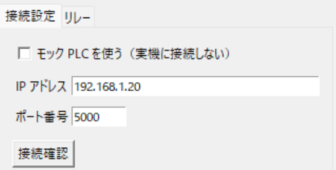
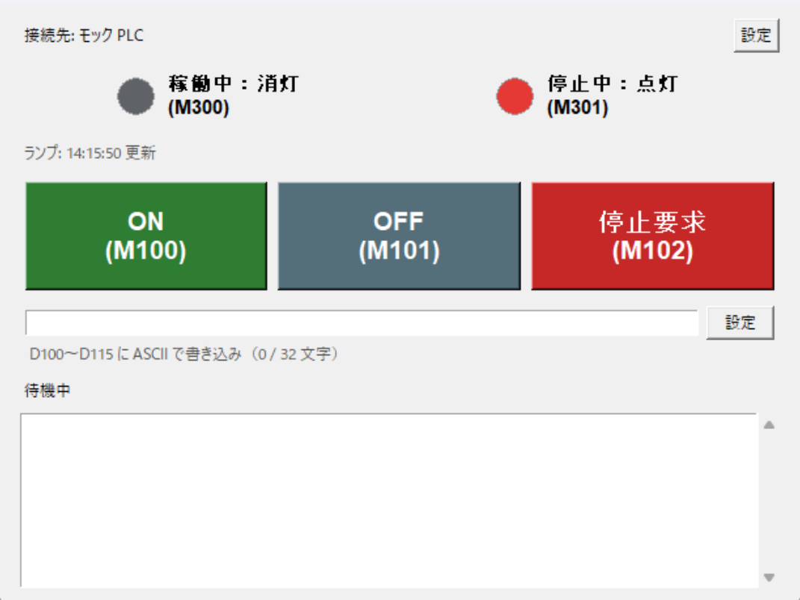
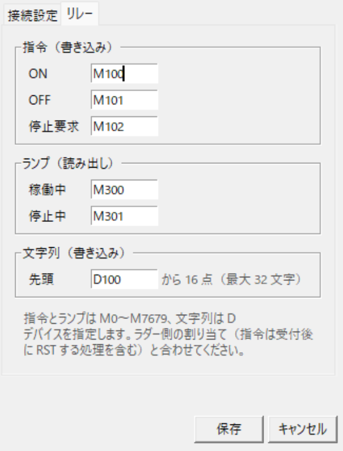

# FX5S Commander

Windows PC から LAN（Ethernet）経由で、三菱電機の PLC「FX5S」を操作するデスクトップアプリです。
SLMP（MC プロトコル 3E フレーム、バイナリ）で通信します。

- ON / OFF / 停止要求のボタンで、PLC の内部リレー（M）に指令を送る
- 稼働中 / 停止中のランプで、PLC の内部リレーの状態を表示する
- 入力した文字列を、データレジスタ（D100〜D115）に ASCII で書き込む

> [!WARNING]
> 停止要求は非常停止ではありません。非常停止は、このアプリとは独立した安全回路で実装してください。
> 安全性を確認できるまでは、PLC の出力に実機をつながない状態で検証してください。

## 必要なもの

- Windows 11
- Python 3.11 以上（3.12 で動作確認）
- 三菱電機 FX5S と、LAN で PC とつながる環境（実機がなくても、モック PLC で画面の動作は試せます）

## インストール

リポジトリを取得したフォルダで、次を実行します。

```powershell
py -3.12 -m venv .venv
.\.venv\Scripts\Activate.ps1
pip install -e .
```

## PLC 側の準備（GX Works3）

**パラメータ → FX5SCPU → モジュールパラメータ → イーサネットポート → 基本設定** で設定します。

| 項目 | 設定 |
|---|---|
| 自ノード設定 → IP アドレス | PLC の IP アドレス（例: 192.168.0.101）。PC と同じネットワークにする |
| 自ノード設定 → 交信データコード | **バイナリ** |
| 相手機器接続構成設定 | **SLMP 接続機器** を追加し、プロトコルを **TCP**、ポート番号を決める（例: 8912） |

設定したら、パラメータを PLC に書き込んで **PLC をリセット**（電源の入れ直しか RESET スイッチ）してください。

ラダーには次の対応が必要です。回路例は [docs/ladder.md](docs/ladder.md) にあります。

- ON / OFF / 停止要求の M を受け付けたら、**ラダー側で RST して OFF に戻す**（アプリはこれで「受け付けた」と判断します）
- ランプ用の M（稼働中・停止中）を作る

## 起動

```powershell
.\.venv\Scripts\Activate.ps1
fx5s-commander
```

初めて起動したら、右上の **[設定]** で接続先を設定します。

1. **[接続設定]** タブで、PLC の **IP アドレス** と **ポート番号** を入力する
2. **[接続確認]** を押して「接続 OK」と表示されることを確かめる（読み出しだけで、書き込みはしません）
3. **[保存]** を押す



実機がないときは「**モック PLC を使う**」にチェックを入れて保存すると、ラダーの動きを真似るモック PLC で試せます。

## 画面の使い方



上から、接続先と [設定] ボタン、ランプ、指令のボタン、文字列の入力欄、結果の表示（「待機中」の部分）、ログです。画像はモック PLC で動かしたときのものです。

### ランプ

0.5 秒ごとに PLC から読み出し、M が ON なら点灯します（稼働中は緑、停止中は赤）。読み出せないときは灰色で「不明」になり、3 秒ごとにつなぎ直します。

### ON / OFF / 停止要求ボタン

押すと M を ON にし、ラダーが OFF に戻すのを待ちます。結果は次のように表示されます。

| 表示 | 意味 |
|---|---|
| 指令を PLC が受け付けました | ラダーが M を OFF に戻した。**設備が動いたことまでは意味しない** |
| PLC が OFF に戻さなかったため、指令を取り消しました | 1 秒以内に受け付けられなかったので、アプリが M を OFF に戻した。ラダーの RST を確認する |
| 前回の指令が PLC で未処理のため送信しませんでした | M が既に ON だった |
| 送信できませんでした | 通信エラー |

送信中は ON / OFF を押せません。停止要求は送信中でも押せて、ほかの指令より先に送ります。

### 文字列の書き込み

入力欄に文字列を入れて **[設定]**（または Enter）を押すと、D100〜D115 に書き込みます。

- 最大 32 文字。半角の英数字と記号のみ（日本語は不可）
- 1 点に 2 文字ずつ、先の文字を下位バイトに入れます。例: `SOS` → D100 = H4F53, D101 = H0053
- 毎回 16 点すべてを書き、文字のない部分は 0 にします。空欄で押すと 16 点すべてが 0 になります
- 書き込んだあと読み直して、一致を確認します

### ログ

画面のログ欄には、指令と文字列の書き込みの結果が出ます。通信状況（ランプの読み出しや接続確認）を含む詳しいログは、起動したコンソールと `logs/fx5s-commander.log` に出ます。

## 設定

[設定] 画面の内容は `config.toml`（アプリを起動したフォルダ）に保存されます。

| タブ | 項目 | 既定値 |
|---|---|---|
| 接続設定 | モック PLC を使う / IP アドレス / ポート番号 | オフ / 192.168.1.20 / 5000 |
| リレー | 指令（ON / OFF / 停止要求）。M のみ | M100 / M101 / M102 |
| リレー | ランプ（稼働中 / 停止中）。M のみ | M300 / M301 |
| リレー | 文字列の書き込み先の先頭。D のみ、そこから 16 点 | D100 |



[リレー] タブの割り当ては、ラダー側の割り当て（指令用の M を受け付け後に RST する処理を含む）と合わせてください。

PLC 種別、タイムアウト、ランプの読み出し間隔など、画面にない項目は `config.toml` を直接編集します。書式と説明は [config.example.toml](config.example.toml) にあります。画面から保存すると、`config.toml` 内のコメントは消えます。

安全のため、書き込めるのは設定した指令用の M と、文字列用の D 16 点だけです。

## うまくつながらないとき

| 症状 | 確認すること |
|---|---|
| 「タイムアウト」になる | PC と PLC の IP アドレスが同じネットワークか。LAN ケーブル。PC 自身の IP アドレスを接続先にしていないか |
| 「拒否されました」になる | GX Works3 で SLMP 接続機器（TCP、同じポート番号）を設定し、書き込んで PLC をリセットしたか |
| 指令が「取り消しました」になる | ラダーで指令用の M を RST しているか |
| ランプが点かない | ラダーでランプ用の M（稼働中・停止中）を作っているか |

コマンドで通信だけ確かめることもできます（M の読み書きのみ）。

```powershell
fx5s-probe --host 192.168.0.101 --port 8912 connect
fx5s-probe --host 192.168.0.101 --port 8912 read M100
```

## 開発者向け

```powershell
pip install -e ".[dev]"
pytest
ruff check .
ruff format .
```

設計と未決定事項は [docs/design.md](docs/design.md)、ラダーの回路例は [docs/ladder.md](docs/ladder.md) にあります。

| パス | 内容 |
|---|---|
| `src/fx5s_commander/gui.py` | メイン画面（tkinter） |
| `src/fx5s_commander/settings_window.py` | 設定画面 |
| `src/fx5s_commander/worker.py` | 通信用のバックグラウンドスレッド |
| `src/fx5s_commander/commands.py` | 指令の送信と受付確認 |
| `src/fx5s_commander/monitor.py` | ランプ用の状態読み出し |
| `src/fx5s_commander/text.py` | 文字列の書き込み |
| `src/fx5s_commander/plc/` | PLC 通信（実機用、モック、書き込みガード） |
| `src/fx5s_commander/config.py` | 設定ファイルの読み込みと保存 |
| `src/fx5s_commander/probe.py` | 通信確認用のコマンドラインツール |

## ライセンス

[MIT](LICENSE)
